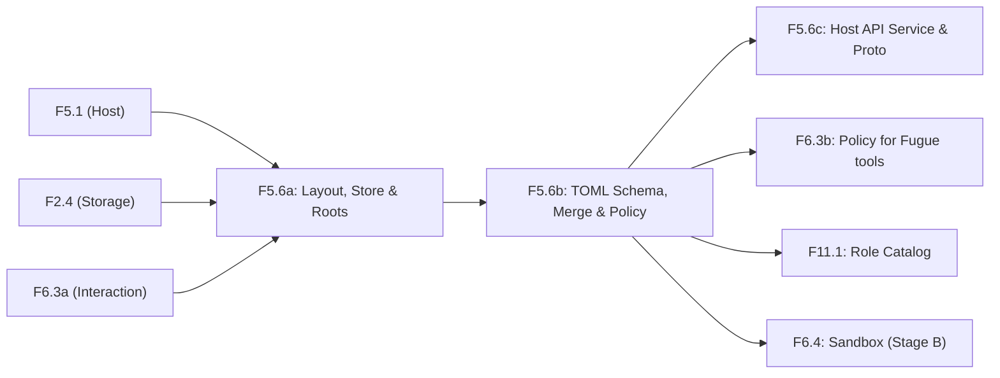

# Kế hoạch thực hiện F5.6: Workspace và Cấu hình

Trạng thái: **Đang lập kế hoạch** (vòng viết plan & phân tích độ lệch thiết kế, không có code production).  
Nhánh: `docs/f5.6-plan`  
Tài liệu liên quan: base-doc `workspace.mdx` (v0.13), `vendor-runtime.mdx` (v0.2), `interaction.mdx` (v0.14), `orchestration.mdx` (v0.2), `desktop-app.mdx` (v0.3/v0.4), `activation.mdx` (v0.14), `git-guard.mdx` (H-50, PR syurodev/base#12).

---

## 1. Bảng đối chiếu quyết định WS-01 đến WS-09 với giai đoạn A (Vendor Runtime)

Trang `workspace.mdx` (v0.13, 2026-11-04) được thiết kế cho harness native trước khi chuyển trục sang vendor runtime (`activation` v0.14, 2026-11-07). Dưới đây là bảng đối chiếu chi tiết từng quyết định:

| ID | Quyết định gốc (v0.13) | Trạng thái giai đoạn A | Phân tích & Cách áp dụng trong giai đoạn A |
| --- | --- | --- | --- |
| **WS-01** | Workspace là thư mục `~/Fugue/workspaces/<id>/` (`id` là UUIDv7) cộng **các root có tên**, nằm ở bất kỳ đâu; mỗi root `rw` hoặc `ro`. | **Giữ nguyên** | Cấu trúc layout thư mục và mô hình root có tên `rw`/`ro` giữ nguyên. Tuy nhiên, ở giai đoạn A phiên vendor solo/lead chạy trực tiếp trong root do user chọn; các root bổ sung được truyền qua CLI options tương ứng (`--add-dir` của Claude, `additionalDirectories` của agy, writable roots của Codex) thay vì mount jail. |
| **WS-02** | Thư mục workspace là **cwd ban đầu** của session và gốc của path tương đối. Code được truy cập bằng path thật của root; không có symlink. | **Áp dụng khác đi** | **Khác biệt quan trọng**: Với vendor runtime (VR-06), CLI chính chủ (Claude Code, Codex, agy) giả định chạy trong root của dự án (repo git) để đọc index, git status, commit history. Nếu cwd là `~/Fugue/workspaces/<id>/`, vendor CLI sẽ không nhận diện được repo dự án. Do đó: <br>1) Cwd ban đầu của phiên vendor solo/lead là **thư mục root mà user chọn** (hoặc root chính của workspace); phiên worker chạy trong **git worktree** do Fugue tạo (`orchestration` §9). <br>2) Thư mục `~/Fugue/workspaces/<id>/` là nơi chứa cấu hình, metadata (`fugue.toml`, `WORKSPACE.md`, `AGENTS.md`) và `scratch/` dùng chung. <br>3) Code vẫn được truy cập bằng path thật (sau khi resolve symlink). |
| **WS-03** | Thư mục đặt theo `id`, không theo tên; đổi tên workspace chỉ sửa `fugue.toml`. | **Giữ nguyên** | Thư mục vật lý luôn cố định là `~/Fugue/workspaces/<id>/`. Đổi tên chỉ thay đổi trường `name` trong `fugue.toml` và cập nhật `WORKSPACE.md`. |
| **WS-04** | **File là nguồn gốc** của cấu hình; `fugue.db` chỉ giữ định danh, revision và hash để phát hiện thay đổi. | **Giữ nguyên** | Bảng `workspaces` trong SQLite chỉ lưu `workspace_id`, `config_revision`, `policy_revision`, `config_hash`, `missing_roots`, `created_at`. Không lưu nội dung cấu hình trong database. Nguồn sự thật duy nhất là các file TOML trên đĩa. |
| **WS-05** | Bốn tầng cấu hình, tầng sau thắng tầng trước: (1) mặc định có sẵn, (2) `~/Fugue/config.toml`, (3) `fugue.toml` của workspace, (4) session. | **Giữ nguyên** | Mô hình 4 tầng và luật gộp (scalar ghi đè, array thay thế toàn bộ trừ khi dùng `_add`, cấm vừa dùng `xxx` vừa `xxx_add` trong cùng 1 tầng) giữ nguyên. Tầng 4 ở giai đoạn A được thiết lập qua `StartSpec` khi tạo phiên vendor hoặc qua `SetSessionPolicy` trên Host API. |
| **WS-06** | Format TOML, decode chặt: key lạ là lỗi. | **Giữ nguyên** | Cấu hình dùng TOML v1.0. Decode chặt: key lạ, sai kiểu, ngoài khoảng giá trị, sai enum đều bị từ chối ngay lập tức kèm thông tin vị trí `file:dòng:cột` và tên key. |
| **WS-07** | Agent không sửa được cấu hình: jail mount chỉ đọc, tool file có `confirm: always`, workspace khác bị chặn đọc. | **Áp dụng khác đi & Để giai đoạn B** | **Khác biệt quan trọng**: <br>1) Trong giai đoạn A, Fugue **không bọc jail quanh CLI của vendor** (VR-04) và tool của vendor **không đi qua policy/file gateway của Fugue** (VR-05, VR-13). <br>2) Ranh giới cứng bằng jail mount read-only và kiểm soát tool file (`edit`, `write`) chuyển sang **giai đoạn B** cùng harness native (F6.4, F6.8). <br>3) **Biện pháp giai đoạn A**: <br>- Cwd của vendor CLI nằm ở root dự án, tách biệt khỏi `~/Fugue/`. <br>- Quyền file của `~/Fugue/` và các file cấu hình được bảo vệ ở mức `0700` / `0600` (chỉ user sở hữu). <br>- Tool MCP do Fugue phục vụ (`fugue mcp-bridge`) từ chối mọi path trỏ vào `~/Fugue/` và data dir. <br>- Host giám sát `config_hash`; nếu file bị sửa ngoài ý muốn, host phát hiện ngay và cảnh báo. |
| **WS-08** | Cấu hình không nới được luật cứng và không chứa secret. | **Giữ nguyên** | TOML schema không có trường cho secret (API key, password). Bộ validate từ chối mọi nỗ lực nới luật cứng I-03 (tag `prod` luôn `requires_confirmation = true`, quan trọng luôn hỏi ở mọi mode, không thể bypass bằng `shell_allow`). |
| **WS-09** | Đổi cấu hình áp dụng ở ranh giới step kế tiếp; đổi khóa policy thì mọi grant của workspace bị bỏ. | **Áp dụng khác đi** | **Khác biệt quan trọng**: <br>1) Với phiên vendor, không có vòng lặp step native của kernel. "Ranh giới step" ở giai đoạn A tương ứng với **ranh giới giữa các lượt (turn boundaries)** hoặc **ranh giới giữa các lần gọi tool MCP / checks của Fugue**. <br>2) Khi đổi policy keys hoặc đổi quyền root (`rw` ↔ `ro`), `policy_revision` tăng và **toàn bộ grant trong `internal/interaction` của workspace bị hủy bỏ**. <br>3) Không có `ContextInjected` native của kernel (hoãn sang B); việc khởi động lại jail khi đổi root cũng hoãn sang B (F6.4). Thay vào đó, thay đổi root được phản ánh vào metadata, `WORKSPACE.md`, và phiên kế tiếp/lượt kế tiếp. |

### Các điểm điều chỉnh kiến trúc bổ sung

1. **Quản lý Workspace qua Host API thay cho CLI**:
   - Theo quyết định `activation` A-06 và `desktop-app` DA-07, DA-09: Desktop app (Gio) là **client duy nhất** của giai đoạn A.
   - Các lệnh CLI `fugue workspace ...` (new, list, show, root, edit, rm) và cơ chế tự chọn workspace theo cwd trong terminal chuyển sang **giai đoạn B** (F7.1).
   - Mọi thao tác quản lý workspace trong giai đoạn A được phục vụ qua **Host API** (`fugue.workspace.v1` Connect RPC) để Desktop App hiển thị ở thanh bên, màn hình Cài đặt, và điều khiển.

---

## 2. Phạm vi giai đoạn A đề xuất

### 2.1 Layout thư mục `~/Fugue/` và `workspaces/<id>/`

Layout đĩa do `internal/workspace` quản lý:

```text
~/Fugue/                              ← gốc của Fugue cho user; cấu hình qua SYNX_FUGUE_HOME
  config.toml                         ← cấu hình chung (tầng 2), gồm [host]
  workspaces/
    <workspace_id>/                   ← workspace_id là UUIDv7 chuẩn
      fugue.toml                      ← cấu hình workspace (tầng 3): name, [[roots]], overrides
      AGENTS.md                       ← rule cá nhân của workspace (tùy chọn)
      WORKSPACE.md                    ← Fugue tự động sinh khi root đổi; chỉ đọc
      scratch/                        ← thư mục nháp dùng chung cho các session của workspace
```

- **Phân định rõ ràng**: `~/Fugue/` (chứa cấu hình và workspace của user) hoàn toàn tách biệt với **Data Directory** (`SYNX_FUGUE_DATA_DIR`, mặc định `os.UserConfigDir()/Fugue`), nơi lưu `fugue.db`, vault, sockets và temporary worktrees.
- **Quyền truy cập file**: Thư mục tạo mới với quyền `0700` (`drwx------`), file tạo mới với quyền `0600` (`-rw-------`).

### 2.2 Quản lý Root có tên rw/ro

- `name`: Định dạng regex `^[a-z0-9][a-z0-9-]{0,31}$`, duy nhất trong cùng một workspace.
- `path`: Đường dẫn tuyệt đối sau khi mở rộng `~` và resolve symlink (`filepath.EvalSymlinks`). Thư mục bắt buộc phải tồn tại trên đĩa tại thời điểm thêm.
- `access`: Enum `"rw"` hoặc `"ro"`.
- **Ranh giới an toàn**:
  - Root không được lồng nhau trong cùng một workspace (root A không được là cha, con hoặc trùng với root B).
  - Root không được nằm trong `~/Fugue/` hoặc trong data directory.
  - Hai workspace khác nhau được phép dùng chung một root.
  - Workspace được phép không có root nào (khi đó chỉ dùng `scratch/`).
- **File `WORKSPACE.md`**:
  - Fugue tự động tái sinh mỗi khi danh sách root hoặc quyền truy cập thay đổi.
  - Chứa: ID workspace, tên workspace, danh sách từng root kèm tên, đường dẫn thật và quyền (`rw`/`ro`). User và model chỉ đọc, không sửa tay.

### 2.3 Bảng `workspaces` và Storage Migration

File migration `internal/storage/migrations/0007_workspaces.sql`:

```sql
CREATE TABLE IF NOT EXISTS workspaces (
    workspace_id TEXT PRIMARY KEY,
    config_revision INTEGER NOT NULL DEFAULT 1,
    policy_revision INTEGER NOT NULL DEFAULT 1,
    config_hash TEXT NOT NULL,
    missing_roots TEXT NOT NULL DEFAULT '[]', -- JSON array các root name bị mất trên đĩa
    created_at TEXT NOT NULL
);
```

- Owner: package `internal/workspace`.
- Tuân thủ nguyên tắc WS-04: Bảng này chỉ lưu metadata định danh, revision và hash để phát hiện sửa đổi đồng thời / thay đổi ngoài luồng. Tên workspace, cấu hình và danh sách root nằm hoàn toàn trong file `fugue.toml`.

### 2.4 Bốn tầng TOML với Decode chặt và Hợp nhất

- **Bốn tầng cấu hình**:
  - **Tầng 1**: Mặc định nhúng sẵn trong mã nguồn Go (`internal/workspace/defaults.go`).
  - **Tầng 2**: `~/Fugue/config.toml` (cấu hình mặc định chung cho toàn bộ workspace, cộng thêm bảng `[host]`).
  - **Tầng 3**: `~/Fugue/workspaces/<id>/fugue.toml` (cấu hình riêng của workspace, cộng thêm `name` và `[[roots]]`).
  - **Tầng 4**: Session overrides (truyền qua `StartSpec` khi khởi tạo phiên vendor hoặc `SetSessionPolicy`).
- **Decode chặt (Strict decoding)**:
  - Sử dụng thư viện TOML hỗ trợ bắt unknown keys / strict decode.
  - Bất kỳ key lạ, sai kiểu, giá trị ngoài phạm vi, enum không hợp lệ đều trả về lỗi có kiểu kèm chính xác `file:dòng:cột` và tên key.
- **Luật hợp nhất (Merge semantics)**:
  - Giá trị đơn (scalar) và bảng (table) ghi đè theo từng key.
  - Mảng (array) thay thế toàn bộ mảng của tầng dưới, TRỪ các mảng có hậu tố `_add` dùng để nối thêm vào mảng của tầng dưới.
  - Trong cùng một tầng, cấm dùng đồng thời cả `xxx` và `xxx_add`.
  - Hỗ trợ truy vấn cấu hình hiệu dụng (`GetEffectiveConfig`) kèm nguồn gốc xuất xứ (provenance) của từng giá trị (chỉ rõ giá trị đến từ tầng 1, 2, 3 hay 4).

### 2.5 Các khoá cấu hình mà các hạng mục sau cần

Schema TOML trong giai đoạn A hỗ trợ đầy đủ các trường sau:

1. **Phục vụ F6.3b (Policy cho Fugue tools)**:
   - `policy.approval_mode`: Mặc định `"auto"` (các mode: `"plan"`, `"ask"`, `"auto"`, `"full"`).
   - `policy.sandbox_profile`: Mặc định `"workspace-write"` (các profile: `"read-only"`, `"workspace-write"`, `"full-access"`).
   - `policy.shell_ask`, `policy.shell_allow` (+ `policy.shell_ask_add`, `policy.shell_allow_add`): Danh sách tiền tố lệnh shell cho luật tĩnh.
   - `policy.env_tags`: Danh sách mapping target `{ match = "...", tag = "..." }`.
2. **Phục vụ F11.1 (Danh mục vai trò - Role Catalog)**:
   - `[[roles]]`: Danh sách vai trò của đội:
     - `name`: Tên vai trò (`"researcher"`, `"coder"`, `"reviewer"`, ...).
     - `description`: Mô tả công việc.
     - `vendor`: Vendor mặc định (`"claude"`, `"codex"`, `"agy"`).
     - `model`: Model gợi ý.
     - `effort`: Mức suy nghĩ (effort level).
     - `profile`: Tên hồ sơ phiên gợi ý.
     - `permission`: `"read"` hoặc `"write"`.
     - `is_lead_eligible`: Boolean, vai trò có được làm trưởng nhóm không.
     - `checks`: Danh sách lệnh kiểm tra mặc định của vai trò.
3. **Phục vụ F9.9 (Hồ sơ phiên và thư mục session)**:
   - `[profiles.<name>]`: Hồ sơ phiên vendor:
     - `vendor`: `"claude"`, `"codex"`, `"agy"`.
     - `model`: Tên model.
     - `effort`: `"low"`, `"medium"`, `"high"`.
     - `setting_sources`: `"project"`, `"user"`.
     - `isolate_config`: Boolean.
   - `session.scratch_dir`: Cấu hình đường dẫn thư mục tạm/nháp.
4. **Phục vụ H-50 Git Guard (nếu PR syurodev/base#12 được duyệt)**:
   - Cấu hình theo root hoặc workspace:
     - `roots.<name>.git_guard.push_guard`: Boolean (`true`/`false`), bật tính năng xác nhận pre-push hook.
     - `roots.<name>.git_guard.turn_diff`: Boolean.
     - `roots.<name>.git_guard.secret_scan`: Boolean.
5. **Cấu hình Host (`[host]`, chỉ ở tầng 2 `~/Fugue/config.toml`)**:
   - `host.workspaces_dir`: Mặc định `~/Fugue/workspaces`.
   - `host.output_retention_total`: Mặc định `512MiB`.
   - `host.seen_versions_per_session`: Mặc định `32MiB`.
   - `host.snapshot_disk`: Mặc định `1GiB`.
6. **Khác**:
   - `redact.allow_keys`, `redact.allow_paths` (+ `_add`): Danh sách ngoại lệ redact an toàn nội dung.

### 2.6 Cơ chế `policy_revision`

- **Định nghĩa khóa policy**:
  - Mọi khóa thuộc bảng `policy.*` (`approval_mode`, `sandbox_profile`, `shell_ask`, `shell_allow`, `env_tags`).
  - Mọi khóa thuộc bảng `env.*` (`keep`, `override_allow`).
  - Mọi khóa thuộc bảng `redact.*` (`allow_keys`, `allow_paths`).
  - Mọi thay đổi về quyền truy cập của root (`rw` ↔ `ro`) hoặc thay đổi tên/đường dẫn root.
- **Hành vi kích hoạt**:
  - Khi host phát hiện cấu hình hợp lệ mới có thay đổi ở bất kỳ khóa policy nào nêu trên:
    1. Tăng `policy_revision` của workspace trong database `workspaces`.
    2. Thông báo sang `internal/interaction` để **hủy bỏ đồng bộ toàn bộ session grants** hiện có của các phiên thuộc workspace đó (do grant key gắn chặt với `policyRevision`).
    3. Phát event cập nhật trên topic event của workspace.
  - Các thay đổi cấu hình không thuộc nhóm policy (ví dụ `host.*`, `roles.*`, `profiles.*`) chỉ làm tăng `config_revision`, áp dụng lặng lẽ mà không làm tăng `policy_revision` hay hủy grant.

### 2.7 Service và Protobuf cho Desktop App

Định nghĩa hợp đồng tại `proto/fugue/workspace/v1/workspace.proto`:

- **RPCs của `WorkspaceService`**:
  - `CreateWorkspace(CreateWorkspaceRequest) returns (CreateWorkspaceResponse)`: Tạo thư mục, sinh file `fugue.toml`, `WORKSPACE.md`, ghi nhận vào database.
  - `ListWorkspaces(ListWorkspacesRequest) returns (ListWorkspacesResponse)`: Liệt kê các workspace, tóm tắt danh sách root, cảnh báo root bị mất (`missing_roots`).
  - `GetWorkspace(GetWorkspaceRequest) returns (GetWorkspaceResponse)`: Lấy chi tiết workspace, metadata, danh sách root, nội dung TOML thô và `config_hash`.
  - `GetEffectiveConfig(GetEffectiveConfigRequest) returns (GetEffectiveConfigResponse)`: Trả về cấu hình đã hợp nhất sau 4 tầng, kèm metadata nguồn gốc của từng trường (provenance).
  - `UpdateWorkspaceConfig(UpdateWorkspaceConfigRequest) returns (UpdateWorkspaceConfigResponse)`: Nhận nội dung TOML mới và `expected_hash` (kiểm tra CAS chống ghi đè chéo). Validate chặt; nếu lỗi trả về mảng chi tiết vị trí; nếu hợp lệ ghi đè file và cập nhật revision/hash.
  - `AddRoot(AddRootRequest) returns (AddRootResponse)`: Thêm root mới (validate đường dẫn, symlink, không lồng nhau), cập nhật `fugue.toml`, sinh lại `WORKSPACE.md`.
  - `RemoveRoot(RemoveRootRequest) returns (RemoveRootResponse)`: Gỡ root khỏi workspace, cập nhật file và hủy grant liên quan.
  - `UpdateRoot(UpdateRootRequest) returns (UpdateRootResponse)`: Đổi tên, đổi đường dẫn hoặc đổi quyền `rw`/`ro` của root.
  - `DeleteWorkspace(DeleteWorkspaceRequest) returns (DeleteWorkspaceResponse)`: Xóa thư mục workspace và bản ghi trong DB (yêu cầu xác nhận).
  - `ValidateConfig(ValidateConfigRequest) returns (ValidateConfigResponse)`: Kiểm tra cú pháp và ngữ nghĩa một chuỗi TOML mà không lưu xuống đĩa.
- **Topic event**:
  - Topic `workspace:<id>` hoặc `workspaces`: Bắn event khi cấu hình hoặc danh sách root thay đổi để Desktop App (Gio) tự động render lại UI sidebar và setting.

---

## 3. Bảo mật (Security Controls)

1. **Đường dẫn thật và Symlink (Symlink Evaluation)**:
   - Mọi đường dẫn root khi thêm vào cấu hình bắt buộc phải qua `filepath.EvalSymlinks`. Đường dẫn lưu trong cấu hình và dùng để so khớp quyền luôn là canonical absolute path.
   - Ngăn chặn triệt để tấn công vượt ranh giới bằng symlink: Symlink trỏ vào `~/Fugue/` hoặc data directory bị từ chối với lỗi có kiểu `workspace.path_denied`.
   - Định kỳ hoặc khi nạp lại cấu hình, nếu symlink bị tráo hoặc đích đến không còn tồn tại, root lập tức bị đánh dấu là `missing`.
2. **Root trùng hoặc lồng nhau (Root Overlap and Nesting Prevention)**:
   - Thuật toán kiểm tra chặt chẽ: Đối với bất kỳ cặp root `(r1, r2)` trong cùng một workspace, kiểm tra `r1.Path` không phải là tiền tố thư mục của `r2.Path` và ngược lại.
   - Không cho phép root trùng đường dẫn thật trong cùng một workspace.
   - Ngăn chặn xung đột chính sách (ví dụ: cha là `ro`, con là `rw`) và xung đột shadow git snapshot.
3. **Quyền file và phân quyền hệ điều hành (0600 / 0700 & Owner Checks)**:
   - Mọi thư mục Fugue tạo ra (`~/Fugue/`, `workspaces/`, `workspaces/<id>/`, `scratch/`) đều thiết lập quyền `0700` (`rwx------`).
   - Mọi file cấu hình và metadata (`config.toml`, `fugue.toml`, `WORKSPACE.md`) đều thiết lập quyền `0600` (`rw-------`).
   - Khi khởi động hoặc quét thư mục, Fugue kiểm tra UID sở hữu. Nếu phát hiện file/thư mục thuộc về user khác hoặc quyền mở rộng ra group/world, Fugue tự động siết lại quyền hoặc từ chối khởi động (fail closed), tương tự như cơ chế trust check của socket ở F5.1.
4. **Cấu hình không chứa Secret (WS-08)**:
   - Schema TOML hoàn toàn loại trừ các trường nhạy cảm (không có field chứa API key, token, private key).
   - Mọi credential được quản lý bởi vault hoặc đăng nhập CLI chính chủ (VR-03).
   - Bộ kiểm tra tĩnh và validator của `internal/workspace` từ chối bất kỳ cấu hình nào xuất hiện chuỗi khớp mẫu secret hoặc định nghĩa trường secret lạ.
   - Audit log, error messages và response của Host API chỉ ghi nhận tên trường, hash và revision, tuyệt đối không ghi nội dung nhạy cảm.
5. **Cấu hình không nới được luật cứng I-03**:
   - Luật cứng I-03 khẳng định: Target có env tag yêu cầu xác nhận (`prod`, tag rỗng, tag không biết) và các việc quan trọng của tool system §5.3 luôn luôn phải hỏi user ở mọi approval mode (kể cả Full) và chỉ cho phép lựa chọn "cho 1 lần".
   - Không có bất kỳ khóa TOML nào được phép vô hiệu hóa cờ `requires_confirmation` của tag `prod`.
   - Danh sách tiền tố lệnh `policy.shell_allow` trong TOML không bao giờ được ghi đè hay vượt qua các lệnh nhắm vào target mang tag xác nhận hoặc vi phạm luật cứng I-03. Validator từ chối nạp cấu hình nếu phát hiện vi phạm.

---

## 4. Danh sách kiểm thử theo Workspace §9 (Giai đoạn A vs Giai đoạn B)

| Evidence ID | Nội dung kiểm thử gốc | Phân loại | Diễn giải chi tiết cho giai đoạn |
| --- | --- | --- | --- |
| **WS-E01** | Tạo workspace: thư mục theo `id`, `fugue.toml`, `WORKSPACE.md`; đổi tên không đổi thư mục. | **Giai đoạn A** | Kiểm thử end-to-end việc tạo thư mục, khởi tạo file TOML, sinh `WORKSPACE.md`, đổi tên chỉ cập nhật trường `name` và metadata, giữ nguyên UUIDv7 directory. |
| **WS-E02** | Validate root: lồng nhau, trong `~/Fugue/` hay data dir, tên trùng, path không tồn tại đều bị từ chối; hai workspace dùng chung root được. | **Giai đoạn A** | Kiểm thử toàn diện bộ validator của root: phát hiện lồng nhau, cấm nằm trong thư mục Fugue/data dir, cấm trùng tên, kiểm tra tồn tại sau khi eval symlink; xác nhận 2 workspace dùng chung 1 root hợp lệ. |
| **WS-E03** | Bảng quyền §2.2 cho jail và tool file ở mỗi profile; root `ro` không ghi được ở `full-access`; workspace khác bị chặn đọc; agent không ghi được `fugue.toml` qua shell hay tool file. | **Giai đoạn B** *(Một phần ở A)* | Trong giai đoạn A, Fugue không bọc jail quanh vendor CLI và chưa có native file tools. <br>- **Giai đoạn A kiểm thử**: Quyền file 0600/0700 của host; tool `fugue mcp-bridge` chặn truy cập ngoài phạm vi root. <br>- **Giai đoạn B**: Kiểm thử toàn bộ ma trận quyền của native jail (F6.4) và native file tools (F6.8). |
| **WS-E04** | Chọn workspace theo cwd: một, nhiều, không có. | **Giai đoạn B** | Dành riêng cho giao diện dòng lệnh CLI `fugue` tương tác trong terminal (H-45 / F7.1). Giai đoạn A sử dụng Desktop App là client duy nhất; user chọn và quản lý workspace trực tiếp trên UI app. |
| **WS-E05** | Root mất: đánh dấu, cảnh báo, lỗi có kiểu. | **Giai đoạn A** | Kiểm thử trường hợp thư mục root bị xóa hoặc đổi chỗ trên đĩa: host phát hiện, cập nhật `missing_roots`, trả về mã lỗi có kiểu `workspace.root_missing` khi thao tác trên root đó. |
| **WS-E06** | Thêm root khi có session đang chạy: tool file thấy từ step kế tiếp; jail khởi động lại hoặc hoãn khi có job; khối danh sách root được patch. | **Giai đoạn B** *(Một phần ở A)* | - **Giai đoạn A kiểm thử**: Thêm root qua Host API khi phiên vendor đang mở; tăng `config_revision`, sinh lại `WORKSPACE.md`, phát event cập nhật. <br>- **Giai đoạn B**: Jail khởi động lại, hoãn khi có job, `ContextInjected` vào native model. |
| **WS-E07** | Gỡ root khi có session: hỏi khi có job; gỡ ngay có proof dừng; cwd reset; request chờ bị invalidate; grant và phiên bản đã thấy của root bị bỏ; không restore vào root đã gỡ. | **Giai đoạn B** *(Một phần ở A)* | - **Giai đoạn A kiểm thử**: Gỡ root làm hủy bỏ ngay lập tức các interaction grants của root đó; cập nhật `config_revision` và `WORKSPACE.md`. <br>- **Giai đoạn B**: Hủy job native kèm stop proof, reset cwd của shell trong jail, thu hồi snapshot restore. |
| **WS-E08** | Đổi path, tên, quyền theo §4.3. | **Giai đoạn A** | Kiểm thử `UpdateRoot`: đổi sang `ro` hủy grant ghi; đổi tên/path hủy toàn bộ grant cũ của root; cập nhật `policy_revision` khi đổi quyền `rw` ↔ `ro`. |
| **WS-E09** | Sửa thẳng `fugue.toml` và dùng lệnh cập nhật cho cùng kết quả; lệnh ghi khi file đã đổi bị từ chối (`config_changed`). | **Giai đoạn A** | Kiểm thử CAS update qua Host API: kiểm tra `expected_hash`; nếu file bị sửa ngoài luồng làm lệch hash, API từ chối với lỗi typed `workspace.config_changed`. File watcher nạp lại cấu hình tự động khi file sửa thẳng. |
| **WS-E10** | Key lạ, sai kiểu, ngoài khoảng bị từ chối với vị trí đúng; khóa nới luật cứng bị từ chối. | **Giai đoạn A** | Kiểm thử giải mã chặt (strict decode) của parser TOML: báo đúng dòng/cột/tên key; từ chối bất kỳ cấu hình nào cố tình nới lỏng luật cứng I-03. |
| **WS-E11** | Gộp tầng: ghi đè theo key; mảng thay cả mảng; `_add` thêm vào; dùng cả hai trong một tầng là lỗi; `GetEffectiveConfig` ghi đúng tầng. | **Giai đoạn A** | Kiểm thử logic hợp nhất 4 tầng: scalar override, array replace vs append với `_add`, phát hiện lỗi xung đột `xxx` + `xxx_add`, tính toán chính xác nguồn gốc (provenance) của từng giá trị cấu hình. |
| **WS-E12** | File lỗi: session đang chạy giữ bản hợp lệ gần nhất; session mới bị từ chối. | **Giai đoạn A** | Kiểm thử khả năng chịu lỗi (fault tolerance): Khi file `fugue.toml` bị hỏng cú pháp trên đĩa, host giữ lại cấu hình hợp lệ gần nhất trong memory; các yêu cầu tạo session mới trong workspace bị từ chối với lỗi `workspace.config_invalid`. |
| **WS-E13** | Nạp lại ở ranh giới step; job đang chạy giữ timeout cũ; đổi khóa policy bỏ grant và báo model; đổi cap giữ grant. | **Giai đoạn A** *(Một phần ở B)* | - **Giai đoạn A kiểm thử**: Đổi khóa policy làm tăng `policy_revision` và hủy bỏ grants trong `internal/interaction`; đổi các khóa không thuộc policy thì giữ nguyên grant. <br>- **Giai đoạn B**: Quản lý timeout của native jobs, `ContextInjected` vào native engine. |

---

## 5. Đề xuất tách thành các PR (F5.6a, F5.6b, F5.6c)

Để tuân thủ quy tắc PR gọn gàng (dưới khoảng 1.000 dòng non-test cho mỗi PR) và phân định rõ ràng ranh giới phụ thuộc, F5.6 được đề xuất tách thành 3 sub-items tuần tự:



### Bảng chi tiết các PR thành phần

| Item | Phạm vi công việc | Phụ thuộc | Evidence kiểm chứng | Ước tính dòng non-test |
| --- | --- | --- | --- | ---: |
| **F5.6a** | **Layout thư mục, Workspace Store & Root Management**: <br>- Layout `~/Fugue/` và `workspaces/<id>/`, cấp quyền 0700/0600. <br>- Migration SQLite `0007_workspaces.sql` và CRUD store cho bảng `workspaces`. <br>- Root types, validation (regex tên, canonical path, symlink resolution, non-nesting, cấm trỏ vào `~/Fugue/` hoặc data dir). <br>- Tự động sinh `WORKSPACE.md`. <br>- Phát hiện và đánh dấu root mất (`missing_roots`). | `F5.1`, `F2.4`, `F6.3a` | `WS-E01`, `WS-E02`, `WS-E05` | ~700 dòng |
| **F5.6b** | **TOML Layers, Schema, Validate, Merge & Policy Revision**: <br>- Schema TOML 4 tầng (mặc định nhúng trong code, `config.toml`, `fugue.toml`, session overrides). <br>- Giải mã chặt (strict decode) báo lỗi `file:dòng:cột`. <br>- Semantic validation: cấm secret (WS-08), bảo vệ luật cứng I-03. <br>- Engine hợp nhất 4 tầng, cơ chế `_add`, provenance tracking. <br>- Giám sát file và tính hash SHA-256 (`config_hash`). <br>- Tăng `policy_revision` khi đổi policy keys hoặc quyền root; kích hoạt hook hủy grant trong `internal/interaction`. <br>- Bao gồm schema cho F6.3b (policy), F11.1 (roles), F9.9 (profiles), H-50 git guard. | `F5.6a` | `WS-E09`, `WS-E10`, `WS-E11`, `WS-E12`, `WS-E13` (phần grant) | ~850 dòng |
| **F5.6c** | **Host API Proto & Connect Service cho Desktop App**: <br>- File protobuf `proto/fugue/workspace/v1/workspace.proto`. <br>- Connect handler trong `internal/hostapi` (`WorkspaceService`: Create, List, Get, GetEffective, UpdateConfig với CAS hash, AddRoot, RemoveRoot, UpdateRoot, Delete, ValidateConfig). <br>- Quản lý lỗi công khai: `workspace.not_found`, `workspace.config_invalid`, `workspace.config_changed`, `workspace.root_invalid`, `workspace.root_missing`, v.v. trong `internal/platform/errcode`. <br>- Tích hợp wiring vào `internal/app` backend và phát topic event cập nhật workspace. | `F5.6b`, `F5.1c`, `F5.2` | RPC E2E tests, CAS collision tests, WS-E08 qua API | ~800 dòng |

---

## 6. Danh sách các vị trí cần sửa ở Base-Doc (`workspace.mdx` v0.14)

*(Ghi chú: Đây là danh sách liệt kê các vị trí cần cập nhật trong base-doc để khớp với kiến trúc vendor runtime v0.14; không thực hiện sửa đổi base-doc trong PR này).*

1. **Header và Trạng thái trang (Dòng 8)**:
   - *Hiện tại*: `Trạng thái: v0.13, ngày 2026-11-04`.
   - *Cần sửa*: Nâng lên `v0.14`, bổ sung ghi chú phạm vi theo vendor runtime: giai đoạn A chạy CLI vendor chính chủ; desktop app Gio là client duy nhất; CLI và jail chuyển sang giai đoạn B.
2. **Quyết định WS-02 và Mục 2.3 (Cwd và path của session)**:
   - *Hiện tại*: "Thư mục workspace là cwd ban đầu của session và gốc của path tương đối".
   - *Cần sửa*: Làm rõ rằng đối với phiên vendor solo/lead (VR-06), cwd là root được user chọn (hoặc worktree do Fugue tạo cho worker); thư mục `~/Fugue/workspaces/<id>/` là nơi chứa cấu hình, metadata và scratch dùng chung.
3. **Quyết định WS-07 và Mục 2.2 (Quyền của agent và Jail)**:
   - *Hiện tại*: "Agent không sửa được cấu hình: jail mount chỉ đọc, tool file có confirm: always, workspace khác bị chặn đọc".
   - *Cần sửa*: Làm rõ rằng trong giai đoạn A, Fugue không bọc jail quanh CLI vendor (VR-04); bảo vệ cấu hình dựa trên quyền file 0600/0700, tách biệt cwd và bridge MCP; cơ chế mount jail chỉ đọc và kiểm soát tool file native chuyển sang giai đoạn B (F6.4, F6.8).
4. **Quyết định WS-09 và Mục 7 (Ranh giới step và nạp lại)**:
   - *Hiện tại*: Mô tả nạp lại ở ranh giới step native của kernel, patch `ContextInjected` vào model prompt và khởi động lại jail.
   - *Cần sửa*: Điều chỉnh khái niệm ranh giới step thành ranh giới giữa các lượt (turn) của phiên vendor hoặc các lần gọi tool MCP của Fugue; bỏ việc gửi `ContextInjected` native trong giai đoạn A; khởi động lại jail chuyển sang giai đoạn B.
5. **Mục 3 (Lệnh CLI `fugue workspace ...`)**:
   - *Hiện tại*: Bảng các lệnh CLI `fugue workspace new/list/show/root/edit/rm` và cơ chế chọn workspace theo cwd của lệnh `fugue`.
   - *Cần sửa*: Chuyển toàn bộ các lệnh CLI sang giai đoạn B (H-45 / F7.1); bổ sung hợp đồng Host API `fugue.workspace.v1` làm giao diện điều khiển chính cho Desktop App trong giai đoạn A.
6. **Mục 4 (Thay đổi root khi có session đang chạy)**:
   - *Hiện tại*: Nhắc đến việc khởi động lại jail, hoãn khi có job shell, hỏi interactive "chờ hoặc gỡ ngay".
   - *Cần sửa*: Phân định rõ: trong giai đoạn A việc thay đổi root cập nhật Host API, `WORKSPACE.md` và hủy interaction grants; việc điều khiển tiến trình shell đang chạy trong jail và khởi động lại jail hoãn sang giai đoạn B.
7. **Mục 5.2 (Bảng Khóa cấu hình)**:
   - *Cần sửa*: Bổ sung các khóa mới của giai đoạn A:
     - `[[roles]]`: Danh mục vai trò của đội (orchestration §5.2 / F11.1).
     - `[profiles.<name>]`: Hồ sơ phiên vendor (vendor-runtime §7 / F9.9).
     - `[roots.<name>.git_guard]`: Cấu hình push guard và secret scan theo root (H-50 / git-guard §4).
     - Đánh dấu các khóa chỉ dành riêng cho native harness (`shell.caps`, `jobs.max`, `sandbox.idle_stop`, `tasks.verify`) là Stage B.
8. **Mục 9 (Evidence)**:
   - *Cần sửa*: Đánh dấu rõ các evidence thuộc giai đoạn A (`WS-E01`, `WS-E02`, `WS-E05`, `WS-E08`, `WS-E09`, `WS-E10`, `WS-E11`, `WS-E12`, `WS-E13`) và các evidence hoãn sang giai đoạn B (`WS-E03`, `WS-E04`, `WS-E06`, `WS-E07`).

---

## 7. Câu hỏi mở chờ chủ dự án quyết định (Open Questions)

Các câu hỏi được đánh số từ **Q-60** trở đi (Q-51/Q-52 thuộc PR #104; Q-53 đến Q-59 thuộc plan F9.9):

### Q-60 — Vị trí thư mục gốc Fugue và cơ chế ghi đè đường dẫn (`SYNX_FUGUE_HOME` vs `[host].workspaces_dir`)

- **Bối cảnh**: Base-doc quy định gốc cấu hình của user là `~/Fugue/` (đổi qua `SYNX_FUGUE_HOME`), và `~/Fugue/config.toml` có khóa `[host].workspaces_dir = "~/Fugue/workspaces"`. Đồng thời Fugue có biến `SYNX_FUGUE_DATA_DIR` (`~/.config/Fugue` hoặc `os.UserConfigDir()/Fugue`) cho database và socket. Cần chốt thứ tự ưu tiên khi resolve thư mục chứa workspace.
- **Phương án**:
  - **A (Khuyến nghị)**: Thư mục gốc user mặc định là `~/Fugue/`, ghi đè bằng `SYNX_FUGUE_HOME`. Thư mục workspaces mặc định là `$SYNX_FUGUE_HOME/workspaces`, trừ khi được chỉ định rõ trong `config.toml` qua `[host].workspaces_dir`. `SYNX_FUGUE_DATA_DIR` hoàn toàn độc lập, giữ nguyên cho internal host state.
  - **B**: Gộp chung toàn bộ workspace vào `os.UserConfigDir()/Fugue/workspaces`, không tạo thư mục `~/Fugue/`.
  - **C**: Chỉ dùng `[host].workspaces_dir` trong file cấu hình, bỏ biến môi trường `SYNX_FUGUE_HOME`.
- **Khuyến nghị**: Chọn **A**. Tôn trọng thiết kế ban đầu phân biệt giữa thư mục làm việc của user (`~/Fugue/`) và data directory của hệ thống (`~/.config/Fugue/`), đồng thời cho phép CI/tests chuyển hướng linh hoạt qua biến môi trường.

### Q-61 — Hành vi khi thay đổi root trong workspace đang có phiên vendor hoạt động

- **Bối cảnh**: Trong giai đoạn A, phiên vendor là process CLI độc lập đang chạy trên host. Các tùy chọn thư mục của vendor (như `--add-dir` của Claude Code) được truyền lúc khởi động process và không thể thay đổi động giữa chừng. Nếu user thực hiện thêm, gỡ hoặc đổi quyền root qua Host API trong khi đang có phiên chạy:
- **Phương án**:
  - **A (Khuyến nghị)**: Cập nhật metadata workspace, sinh lại `WORKSPACE.md` và hủy bỏ các grant liên quan trong `internal/interaction` ngay lập tức. Không cưỡng chế dừng hay khởi động lại phiên vendor đang chạy; Desktop App hiển thị thông báo rằng thay đổi root sẽ áp dụng đầy đủ cho phiên kế tiếp hoặc lượt kế tiếp.
  - **B**: Cưỡng chế gửi interrupt và dừng tất cả các phiên vendor đang chạy trong workspace đó khi có bất kỳ thay đổi nào về root.
  - **C**: Từ chối thao tác sửa đổi root (`failed_precondition: workspace.has_active_sessions`) nếu workspace có ít nhất một phiên vendor chưa ở trạng thái `closed`.
- **Khuyến nghị**: Chọn **A**. Tránh gián đoạn trải nghiệm của user khi đang tương tác với model; việc hủy grant của Fugue tools đảm bảo không có tác động trái quyền nào diễn ra từ phía các công cụ do Fugue quản lý.

### Q-62 — Giao diện chỉnh sửa cấu hình workspace trên Desktop App (thay thế cho `$EDITOR` của CLI)

- **Bối cảnh**: Base-doc WS §3 mô tả lệnh `fugue workspace edit` mở file `fugue.toml` bằng `$EDITOR` trong terminal. Trong giai đoạn A, Desktop App (Gio) là client duy nhất và không có widget terminal hay CLI `$EDITOR`.
- **Phương án**:
  - **A (Khuyến nghị)**: Host API cung cấp `GetWorkspace` (trả về raw TOML + `config_hash`), `ValidateConfig` (kiểm tra TOML trả về mảng lỗi có vị trí dòng/cột) và `UpdateWorkspaceConfig` (CAS update bằng hash). Trên Desktop App, màn hình Cài đặt cung cấp cả giao diện form có cấu trúc cho các cài đặt phổ biến (tên, danh sách root, approval mode) VÀ tab soạn thảo mã TOML thô kèm hiển thị lỗi validate tại chỗ.
  - **B**: Desktop App chỉ cung cấp form có cấu trúc, không cho phép soạn thảo TOML trực tiếp trong giai đoạn A.
  - **C**: Desktop App gọi mở trình soạn thảo bên ngoài của OS (theo cấu hình lệnh terminal ngoài ở `desktop-app §5`) và dựa vào file watcher của host để reload.
- **Khuyến nghị**: Chọn **A**. Cung cấp đầy đủ sự tiện lợi cho người dùng phổ thông qua form GUI, đồng thời giữ nguyên sức mạnh tùy biến file TOML cho power users theo đúng tinh thần WS-04 ("File là nguồn gốc cấu hình").

### Q-63 — Phân định schema cho Role Catalog (`[[roles]]`, F11.1) và Session Profiles (`[profiles]`, F9.9) trong F5.6b

- **Bối cảnh**: Cả F11.1 (orchestration teams) và F9.9 (vendor session service) đều cần đọc các section cấu hình tương ứng trong `fugue.toml` / `config.toml`. Quy tắc WS-06 yêu cầu strict decode (từ chối key lạ).
- **Phương án**:
  - **A (Khuyến nghị)**: F5.6b định nghĩa đầy đủ struct schema có kiểu cho `[[roles]]` và `[profiles.<name>]` theo đặc tả của `orchestration §5.2` và `vendor-runtime §7`. Bộ validate kiểm tra tính hợp lệ cơ bản của các trường này. Code của F9.9 và F11.1 khi triển khai sẽ dùng trực tiếp cấu trúc đã được validate từ `internal/workspace`.
  - **B**: F5.6b lưu `roles` và `profiles` dưới dạng `toml.Tree` hoặc `map[string]any` chưa validate, để mặc cho F11.1 và F9.9 tự parse sau.
  - **C**: F5.6b coi `roles` và `profiles` là unknown keys trong PR F5.6b; mỗi khi triển khai F9.9 hay F11.1 sẽ sửa đổi mở rộng schema của `internal/workspace` sau.
- **Khuyến nghị**: Chọn **A**. Đảm bảo đúng nguyên tắc decode chặt của WS-06, ngăn chặn việc phải sửa đi sửa lại schema cốt lõi, và cung cấp hợp đồng cấu hình rõ ràng, ổn định cho cả hai nhóm tính năng song song.
