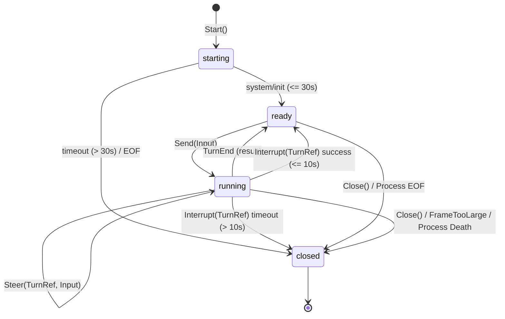

# F9.5b implementation plan (Claude adapter, stage B: process session)

Implement the process-backed `Session` for the Claude Code CLI on `internal/process`, completing
item F9.5 (roadmap F9.5b, `vendor-runtime §5.1, §6, §8, §12, §13`).

## Context and scope

F9.5a (#91, #95) delivered the pure-data half: the `internal/vendor` port, the Claude `Probe`
with pinned version check (2.1.319), the stream-json normalizer into transcript items, real-CLI
fixtures, and data safety tests.

F9.5b delivers the execution half:
1. `claude.Adapter.Start(ctx, StartSpec) (vendor.Session, error)`:
   - Spawns the CLI via `process.Spawn` with an exact, vetted argv.
   - Applies the §8 environment allowlist (via `ProbeEnv`).
   - Carries forward `SessionID`, `XDGRuntimeDir`, and `Probe` to `process.Options`.
   - Executes the 30-second handshake on an injectable clock, awaiting `system/init`.
2. `claude.Session`:
   - `Send(ctx, Input) (TurnRef, error)`: validates input (blocking `/fugue:` with `ErrFugueCommand`),
     mints a unique `TurnRef` via an injectable `ids.Generator`, serializes exactly one stream-json
     user line to stdin, and transitions the session state to `running`. Rejects concurrent turns with
     `ErrBusy`.
   - `Steer(ctx, TurnRef, Input) error`: validates input and verifies the active turn matches `TurnRef`.
     Writes a mid-turn stream-json user message to stdin without allocating a new turn ID.
   - `Interrupt(ctx, TurnRef) error`: transmits a protocol control message interrupt on stdin
     (`{"type":"control_request","request_id":"...","request":{"subtype":"interrupt"}}`). Waits up to 10 s
     on the injected clock for the turn to complete (`TurnEnd` from `result`). If not completed within 10 s,
     escalates to the F9.2 stop order (`Stop(ctx)`: SIGINT -> SIGTERM -> SIGKILL) and transitions session
     state to `closed`.
   - `Resolve(ctx, ApprovalRef, Decision) error`: returns `vendor.ErrUnsupported` fail-closed (reserved for F9.6).
   - `Close(ctx, CloseReason) (process.StopProof, error)`: idempotently closes stdin, executes `Stop(ctx)`,
     and transitions to `closed`.
3. Read stream & normalizer pipeline:
   - Reads stdout line-by-line via `process.LineReader` (enforcing the 8 MiB limit).
   - Feeds each line to `Normalizer.Normalize(line)`.
   - Exposes normalized observations via a bounded channel `Observations() <-chan Observation` (capacity 256).
   - Frame over 8 MiB surfaces `errcode.FrameTooLarge` and terminates the session.
   - Stderr is buffered only in the 64 KiB ring buffer; no raw stderr is logged.
4. `internal/process`:
   - Minimal additive `WriteLine(line []byte) error` on `Process`, guarded by a dedicated `stdinMu`,
     rejecting writes exceeding `MaxFrameSize` with `ErrFrameTooLarge` and closed stdin with `ErrStdinClosed`.

## Exact Argv and Security Denylist

The baseline spawn argv is fixed:
```sh
claude -p --input-format stream-json --output-format stream-json --verbose --include-partial-messages
```

Additive flags appended conditionally only when specified in `StartSpec`:
- `--model <model>` when `StartSpec.Model != ""`
- `--effort <effort>` when `StartSpec.Effort != ""`
- `--resume <session_id>` when `StartSpec.ResumeSessionID != ""`

Security denylist (must never appear in argv under any combination):
- `--dangerously-skip-permissions`
- `--allow-dangerously-skip-permissions`
- `--permission-mode`
- `--allowedTools`
- `--allowed-tools`
- `--disallowedTools`
- `--add-dir`
- `--permission-prompt-tool` (reserved for F9.6)
- `--mcp-config` (reserved for F9.6)

## Session State Machine

The session implements a 4-state state machine:
- `starting`: Process has spawned; handshake loop is awaiting `system/init` within the 30 s deadline.
- `ready`: Session is idle and ready for user input. `Send` is accepted.
- `running`: A turn is currently executing. `Send` returns `ErrBusy`. `Steer` and `Interrupt` are permitted
  for the matching `TurnRef`. The session returns to `ready` upon observing `TurnEnd` from a `result` frame.
- `closed`: Session terminated via `Close`, handshake timeout, frame overflow, unhandled process death, or
  interrupt escalation. All operations return `ErrSessionClosed`.



## Send vs Steer

- `Send(ctx, Input)`:
  - Allowed only when session is in `ready` (idle) state.
  - Generates a new `TurnRef` via `ids.Generator`.
  - Informs normalizer via `normalizer.BeginTurn(turnID)`.
  - Serializes exactly one JSON line: `{"type":"user","message":{"role":"user","content":[{"type":"text","text":in.Text}]}}`.
  - Returns `TurnRef`.
- `Steer(ctx, TurnRef, Input)`:
  - Allowed only when session is in `running` state.
  - Requires `turn.ID == currentTurn.ID`.
  - Does NOT allocate a new turn ID.
  - Serializes the same user message JSON line to stdin while the turn is in-flight.

## Interrupt and Close Paths

- `Interrupt(ctx, TurnRef)`:
  - Validates turn is currently running.
  - Transmits `{"type":"control_request","request_id":"...","request":{"subtype":"interrupt"}}` via `WriteLine`.
  - Awaits turn completion (`obs.TurnEnd != nil`) up to 10 s on the injected clock.
  - If completed within 10 s, session transitions back to `ready` and returns `nil`.
  - If 10 s expires without a turn result, escalates to `proc.Stop(ctx)` (SIGINT -> SIGTERM -> SIGKILL) and transitions to `closed`.
- `Close(ctx, CloseReason)`:
  - Idempotent: multiple calls return the identical `process.StopProof` and `error`.
  - Closes stdin via `proc.CloseStdin()`.
  - Executes `proc.Stop(ctx)`.
  - Returns the resulting `StopProof`.

## Open Questions (Q-43 to Q-47)

### Q-43: Turn identifier generation and format
- **Question**: The vendor domain port returns `TurnRef` from `Session.Send(ctx, Input)`. How should turn IDs be generated and injected?
- **Option A (recommended)**: `StartSpec` accepts an optional `ids.Generator` (defaulting to UUIDv7 via `ids.NewUUIDv7(clock, ids.CryptoRandom{})`). When `Session.Send` is called, a new TurnRef ID is generated from this generator.
- **Option B**: Incremental integer counter formatted as a string (e.g., `turn-1`, `turn-2`).
- **Decision**: Option A selected. Aligns with Fugue's system-wide UUIDv7 standard across entities and preserves chronological ordering across restarts without needing state coordination.

### Q-44: Normalized observation delivery to caller
- **Question**: The session normalizer decodes stdout frames into `claude.Observation` structs (records, updates, streaming partials, turn ends, quota windows). F9.9 connects these to the transcript service. How should `claude.Session` expose them?
- **Option A (recommended)**: A bounded channel `Observations() <-chan Observation` (capacity 256) on `*Session`, closed on session termination. If the buffer is full, the stdout line reader waits, applying backpressure to the vendor process.
- **Option B**: A callback `OnObservation func(Observation)` passed in `StartSpec`.
- **Decision**: Option A selected. Clean decoupled channel consumption without locking or goroutine re-entrancy, easy to select across in F9.9 and unit tests.

### Q-45: Binary path resolution and caching in `Adapter.Start`
- **Question**: How should `Adapter.Start` obtain the verified binary path?
- **Option A (recommended)**: Add additive `BinaryPath string` to `StartSpec`. If provided, `Start` validates that it is absolute and non-empty and uses it directly. If empty, `Start` calls `a.resolveBinary()` (the same check as `Probe`), ensuring no PATH lookup occurs twice if already probed, but remaining self-contained if `Start` is invoked directly.
- **Option B**: Require `Probe` to be called first on the same adapter instance and store the resolved path in adapter state.
- **Decision**: Option A selected. Adapter remains stateless and thread-safe across concurrent sessions; callers who probed can pass the resolved `probe.Path` explicitly in `StartSpec`.

### Q-46: Process stdin write API in `internal/process`
- **Question**: `Session.Send`, `Steer`, and protocol interrupt need to write single lines to vendor stdin without racing with EOF close or stop escalation, while preserving the 8 MiB frame limit. How should `internal/process` support this?
- **Option A (recommended)**: Add minimal `WriteLine(line []byte) error` to `internal/process.Process`, synchronized with a dedicated `stdinMu`, returning typed `ErrStdinClosed` after `CloseStdin` or process termination, and `ErrFrameTooLarge` if length exceeds `MaxFrameSize`.
- **Option B**: Expose the raw `io.WriteCloser` directly.
- **Decision**: Option A selected. Preserves process boundary safety and the 8 MiB invariant in both directions.

### Q-47: Steer capability for Claude Code
- **Question**: How does `Session.Steer(ctx, turn, in)` interact with a running turn?
- **Option A (recommended)**: Claude Code in stream-json mode supports mid-turn input by writing a user message `{"type":"user","message":...}` to stdin while a turn is active. `Steer` validates that the session is in `running` state and the `TurnRef` matches the running turn, encodes the message into a single JSON line on stdin without starting a new turn ID, and returns nil. `Capability().Steer` remains `true`.
- **Option B**: Declare `Steer: false` in `Capability()` and have `Steer` return `vendor.ErrUnsupported`.
- **Decision**: Option A selected. Matches the design spike and vendor capability matrix (`vendor-runtime §6`).

## Plan Tasks

- **Task 1**: `internal/process`: add `WriteLine(line []byte) error` and `ErrStdinClosed`, with tests in `internal/process/spawn_test.go`.
- **Task 2**: `internal/vendor`: update `StartSpec` with additive fields (`Model`, `Effort`, `ResumeSessionID`, `BinaryPath`, `XDGRuntimeDir`, `Probe`, `Clock`, `IDs`), declare `ErrBusy`, `ErrSessionClosed`, `ErrTurnNotRunning`, `ErrHandshakeTimeout`.
- **Task 3**: Real CLI interrupted turn fixture: record and redact `claude-2.1.319-session2-interrupt.jsonl` with golden replay and verify `TestFixturesContainNoHostIdentity`.
- **Task 4**: `internal/vendoradapter/claude`: implement `Adapter.Start` and `Session` (`Send`, `Steer`, `Interrupt`, `Resolve`, `Close`, reader loop, handshake timer, observations channel).
- **Task 5**: Security & behavior tests with fake CLI in `internal/vendoradapter/claude`: argv exact match & denylist, env filtering & secret isolation, JSON line encoding injection resistance, handshake timeout, frame_too_large, interrupt escalation, clean stop.
- **Task 6**: Roadmap cleanup & task check verification across Linux and macOS.
