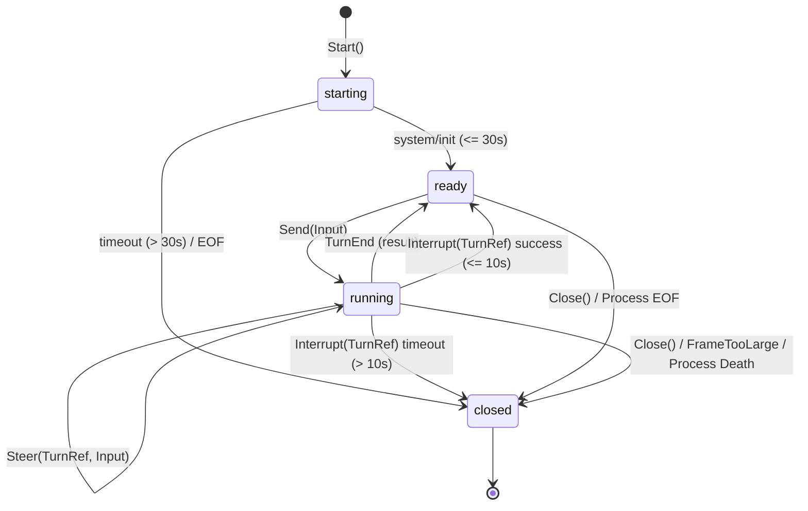

# F9.5b implementation plan (Claude adapter, stage B: process session)

Implement the process-backed `Session` for the Claude Code CLI on `internal/process`, completing
item F9.5 (roadmap F9.5b, `vendor-runtime §5.1, §6, §8, §12, §13`).

## Context and scope

F9.5a (#91, #95) delivered the pure-data half: the `internal/vendor` port, the Claude `Probe`
with pinned version check (2.1.319), the stream-json normalizer into transcript items, real-CLI
fixtures, and data safety tests.

F9.5b delivers the execution half:
1. `claude.Adapter.Start(ctx, StartSpec) (vendor.Session, error)`:
   - Spawns the CLI via `process.Spawn` with an exact, vetted argv.
   - Applies the §8 environment allowlist (via `ProbeEnv`).
   - Carries forward `SessionID`, `XDGRuntimeDir`, and `Probe` to `process.Options`.
   - Executes the 30-second handshake on an injectable clock, awaiting `system/init`.
2. `claude.Session`:
   - `Send(ctx, Input) (TurnRef, error)`: validates input (blocking `/fugue:` with `ErrFugueCommand`),
     mints a unique `TurnRef` via an injectable `ids.Generator`, serializes exactly one stream-json
     user line to stdin, and transitions the session state to `running`. Rejects concurrent turns with
     `ErrBusy`.
   - `Steer(ctx, TurnRef, Input) error`: validates input and verifies the active turn matches `TurnRef`.
     Writes a mid-turn stream-json user message to stdin without allocating a new turn ID.
   - `Interrupt(ctx, TurnRef) error`: transmits a protocol control message interrupt on stdin
     (`{"type":"control_request","request_id":"...","request":{"subtype":"interrupt"}}`). Waits up to 10 s
     on the injected clock for the turn to complete (`TurnEnd` from `result`). If not completed within 10 s,
     escalates to the F9.2 stop order (`Stop(ctx)`: SIGINT -> SIGTERM -> SIGKILL) and transitions session
     state to `closed`.
   - `Resolve(ctx, ApprovalRef, Decision) error`: returns `vendor.ErrUnsupported` fail-closed (reserved for F9.6).
   - `Close(ctx, CloseReason) (process.StopProof, error)`: idempotently closes stdin, executes `Stop(ctx)`,
     and transitions to `closed`.
3. Read stream & normalizer pipeline:
   - Reads stdout line-by-line via `process.LineReader` (enforcing the 8 MiB limit).
   - Feeds each line to `Normalizer.Normalize(line)`.
   - Exposes normalized observations via a bounded channel `Observations() <-chan Observation` (capacity 256).
   - Frame over 8 MiB surfaces `errcode.FrameTooLarge` and terminates the session.
   - Stderr is buffered only in the 64 KiB ring buffer; no raw stderr is logged.
4. `internal/process`:
   - Minimal additive `WriteLine(line []byte) error` on `Process`, guarded by a dedicated `stdinMu`,
     rejecting writes exceeding `MaxFrameSize` with `ErrFrameTooLarge` and closed stdin with `ErrStdinClosed`.

## Exact Argv and Security Denylist

The baseline spawn argv is fixed:
```sh
claude -p --input-format stream-json --output-format stream-json --verbose --include-partial-messages --replay-user-messages
```

Additive flags appended conditionally only when specified in `StartSpec`, guarded by a strict positive allowlist:
- `--effort <effort>`: must be one of `low`, `medium`, `high`, `xhigh`, `max` (source: `claude --help` in Claude Code 2.1.319).
- `--resume <session_id>`: must be a canonical lowercase UUID, validated by `ids.IsUUID`.
- `--model <model>`: must match `^[A-Za-z0-9][A-Za-z0-9._:\[\]-]*$` with max length 128.
- Invalid parameters return `errcode.InvalidArgument` and do NOT echo the input value into the error message.

Security denylist (second layer of defense, must never appear in argv under any combination):
- `--dangerously-skip-permissions`
- `--allow-dangerously-skip-permissions`
- `--permission-mode`
- `--allowedTools`
- `--allowed-tools`
- `--disallowedTools`
- `--add-dir`
- `--permission-prompt-tool` (reserved for F9.6)
- `--mcp-config` (reserved for F9.6)

## Session State Machine

The session implements a 4-state state machine:
- `starting`: Process has spawned; handshake loop is awaiting `system/init` within the 30 s deadline.
- `ready`: Session is idle and ready for user input. `Send` is accepted.
- `running`: A turn is currently executing. `Send` returns `ErrBusy`. `Steer` and `Interrupt` are permitted
  for the matching `TurnRef`. The session returns to `ready` upon observing `TurnEnd` from a `result` frame.
- `closed`: Session terminated via `Close`, handshake timeout, frame overflow, unhandled process death, or
  interrupt escalation. All operations return `ErrSessionClosed`.



## Send vs Steer

- `Send(ctx, Input)`:
  - Allowed only when session is in `ready` (idle) state.
  - Generates a new `TurnRef` via `ids.Generator`.
  - Informs normalizer via `normalizer.BeginTurn(turnID)`.
  - Serializes exactly one JSON line: `{"type":"user","message":{"role":"user","content":[{"type":"text","text":in.Text}]}}`.
  - Returns `TurnRef`.
- `Steer(ctx, TurnRef, Input)`:
  - Allowed only when session is in `running` state.
  - Requires `turn.ID == currentTurn.ID`.
  - Does NOT allocate a new turn ID.
  - Serializes the same user message JSON line to stdin while the turn is in-flight.

## Interrupt and Close Paths

- `Interrupt(ctx, TurnRef)`:
  - Validates turn is currently running under mutex.
  - Acquires `writeSem` channel semaphore (cap 1) with select on `ctx.Done()` and a 10 s timer from the injected clock.
  - If 10 s expires waiting for `writeSem`, logs warning, escalates to `Close(context.WithoutCancel(ctx), CloseHostStop)` and returns `DeadlineExceeded`.
  - Transmits `{"type":"control_request","request_id":"...","request":{"subtype":"interrupt"}}` via `WriteLine`.
  - Awaits turn completion (`obs.TurnEnd != nil`) up to 10 s on the injected clock.
  - If completed within 10 s, returns `nil` and the session returns to `ready`.
  - If `ctx.Done` fires while waiting, returns `ctx.Err()` and does NOT close the session.
  - If 10 s expires or writing fails, escalates to `proc.Stop(context.WithoutCancel(ctx))` (SIGINT -> SIGTERM -> SIGKILL) and transitions to `closed`.
- `Close(ctx, CloseReason)`:
  - Idempotent: multiple calls return the identical `process.StopProof` and `error`.
  - Closes stdin via `proc.CloseStdin()` without waiting on blocked writers.
  - Executes `proc.Stop(ctx)`.
  - Returns the resulting `StopProof`.

## Open Questions (Q-43 to Q-48)

### Q-43: Turn identifier generation and format
- **Question**: The vendor domain port returns `TurnRef` from `Session.Send(ctx, Input)`. How should turn IDs be generated and injected?
- **Option A (recommended)**: `claude.Adapter` accepts an optional `ids.Generator` (defaulting to UUIDv7 via `ids.NewUUIDv7(clock, ids.CryptoRandom{})`). When `Session.Send` is called, a new TurnRef ID is generated from this generator.
- **Option B**: Incremental integer counter formatted as a string (e.g., `turn-1`, `turn-2`).
- **Decision**: Option A decided by the owner: UUIDv7 default on injected clock; `defaultSequenceIDGen` removed; generator injected on `claude.Adapter`.

### Q-44: Normalized observation delivery to caller
- **Question**: The session normalizer decodes stdout frames into `claude.Observation` structs (records, updates, streaming partials, turn ends, quota windows). F9.9 connects these to the transcript service. How should `claude.Session` expose them?
- **Option A (recommended)**: A bounded channel `Observations() <-chan Observation` (capacity 256) on `*Session`, closed on session termination. If the buffer is full, the stdout line reader waits, applying backpressure to the vendor process.
- **Option B**: A callback `OnObservation func(Observation)` passed in `StartSpec`.
- **Decision**: Option A decided by the owner: bounded channel on `*Session` with backpressure.

### Q-45: Binary path resolution and adapter options in `Adapter.Start`
- **Question**: How should `Adapter.Start` obtain the verified binary path and infrastructure dependencies?
- **Option A (recommended)**: `vendor.StartSpec` carries per-session runtime parameters only (`Model`, `Effort`, `ResumeSessionID`, `Cwd`, `Env`, `Home`). Binary path is configured on `claude.Adapter.Binary` (used directly if absolute) or resolved once via `Adapter.Probe(ctx, home)`. Infrastructure options (`Clock`, `IDs`, `SystemdProbe`, `OnEscalation`, `XDGRuntimeDir`) belong to `claude.Adapter` constructor/options.
- **Option B**: Require `Probe` to be called first on the same adapter instance and store the resolved path in adapter state.
- **Decision**: Option A decided by the owner: `vendor.StartSpec` carries per-session parameters only; binary path and infrastructure dependencies configured on `claude.Adapter`.

### Q-46: Process stdin write API in `internal/process`
- **Question**: `Session.Send`, `Steer`, and protocol interrupt need to write single lines to vendor stdin without racing with EOF close or stop escalation, while preserving the 8 MiB frame limit. How should `internal/process` support this?
- **Option A (recommended)**: Add minimal `WriteLine(line []byte) error` to `internal/process.Process`, synchronized with `stdinMu`, returning typed `ErrStdinClosed` after `CloseStdin` or process termination, `ErrInvalidFrame` for embedded newlines, and `ErrFrameTooLarge` if length exceeds `MaxFrameSize`. `CloseStdin` uses atomic flag and closes pipe immediately without waiting on `stdinMu`.
- **Option B**: Expose the raw `io.WriteCloser` directly.
- **Decision**: Option A decided by the owner: minimal `WriteLine` with atomic closed flag, non-blocking `CloseStdin`, and typed errors.

### Q-47: Steer capability for Claude Code
- **Question**: How does `Session.Steer(ctx, turn, in)` interact with a running turn?
- **Option A (recommended)**: Claude Code in stream-json mode supports mid-turn input by writing a user message `{"type":"user","message":...}` to stdin while a turn is active. Verified against real CLI 2.1.319 with fixture `claude-2.1.319-session3-steer.jsonl`: the CLI incorporates the steer message into the same turn, emitting exactly one `result` event. `Steer` validates running turn, writes single-line JSON without starting new turn ID, and `Capability().Steer` remains `true`.
- **Option B**: Declare `Steer: false` in `Capability()` and have `Steer` return `vendor.ErrUnsupported`.
- **Decision**: Option A decided by the owner: real CLI 2.1.319 confirmed case (a) with single turn and single result; `Capability().Steer` remains true.

### Q-48: Steer message arriving after turn result
- **Question**: If a steer message reaches stdin after the active turn has concluded, how should the adapter handle it?
- **Option A (recommended)**: Base argv includes `--replay-user-messages`. When a steer echo arrives after the turn finished, the normalizer identifies it via registered steer UUID, records a `transcript.Notice` (level: "info", code: "late_steer"), and attributes subsequent vendor assistant events and `turn_end` to `vendor-<uuid>`, keeping the Fugue turn state machine uncorrupted and ready for next `Send`. If a subsequent Send message is absorbed into the vendor turn opened by a late steer, it is detected via registered send UUID, emits a notice (`absorbed_into_vendor_turn`), and attributes the turn completion/result back to the Fugue turn. Verified with real CLI 2.1.319 fixture `claude-2.1.319-session4-late-steer.jsonl`.
- **Option B**: Drop late steer events or fail the session.
- **Decision**: Option A decided by the owner: confirmed with real CLI 2.1.319 fixture `claude-2.1.319-session4-late-steer.jsonl` and `--replay-user-messages`; late steer maps to notice and attributes to `vendor-<uuid>` without changing Fugue turn state, and absorbed send is mapped back to the active Fugue turn.

### Q-49: PR size ceiling
- **Question**: The implemented F9.5b scope measures about 1,160 changed non-test lines — above the ~1,000 ceiling.
- **Option A (recommended)**: Accept one PR of about 1,160 lines, as with Q-35 and Q-42.
- **Option B**: Split into two PRs.
- **Decision**: Option A decided by the owner: accept one PR, as Q-35 and Q-42.

## Plan Tasks

- **Task 1**: `internal/process`: add `WriteLine(line []byte) error` and `ErrStdinClosed`, with tests in `internal/process/spawn_test.go`.
- **Task 2**: `internal/vendor`: update `StartSpec` with per-session fields (`Model`, `Effort`, `ResumeSessionID`, `Cwd`, `Env`, `Home`), declare `ErrBusy`, `ErrSessionClosed`, `ErrTurnNotRunning`, `ErrHandshakeTimeout`.
- **Task 3**: Real CLI fixtures: record and redact `claude-2.1.319-session2-interrupt.jsonl`, `claude-2.1.319-session3-steer.jsonl`, and `claude-2.1.319-session4-late-steer.jsonl` with golden replay and verify `TestFixturesContainNoHostIdentity`.
- **Task 4**: `internal/vendoradapter/claude`: implement `Adapter.Start` and `Session` (`Send`, `Steer`, `Interrupt`, `Resolve`, `Close`, reader loop, handshake timer, observations channel, non-wedging `writeSem`).
- **Task 5**: Security & behavior tests with fake CLI in `internal/vendoradapter/claude`: argv exact match & denylist, env filtering & secret isolation, JSON line encoding injection resistance, handshake timeout, frame_too_large, interrupt escalation, clean stop.
- **Task 6**: Roadmap cleanup & task check verification across Linux and macOS.
